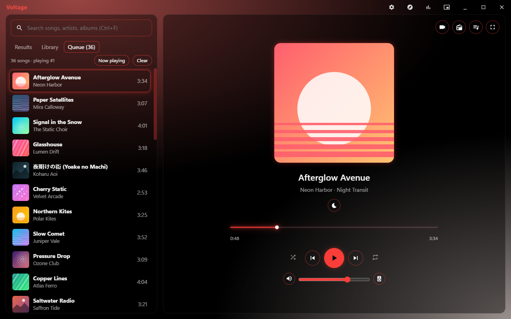
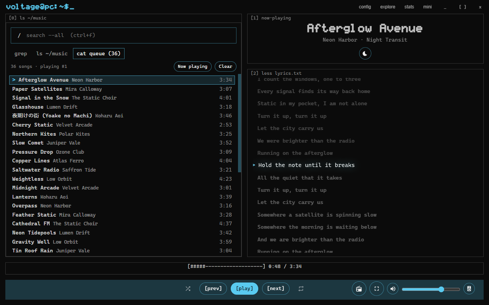
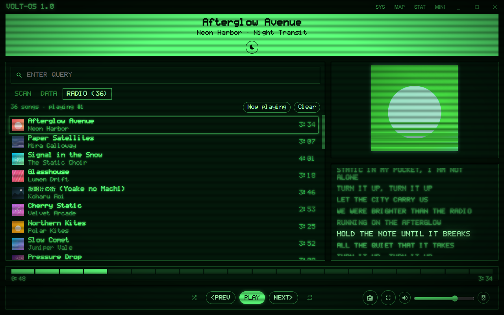
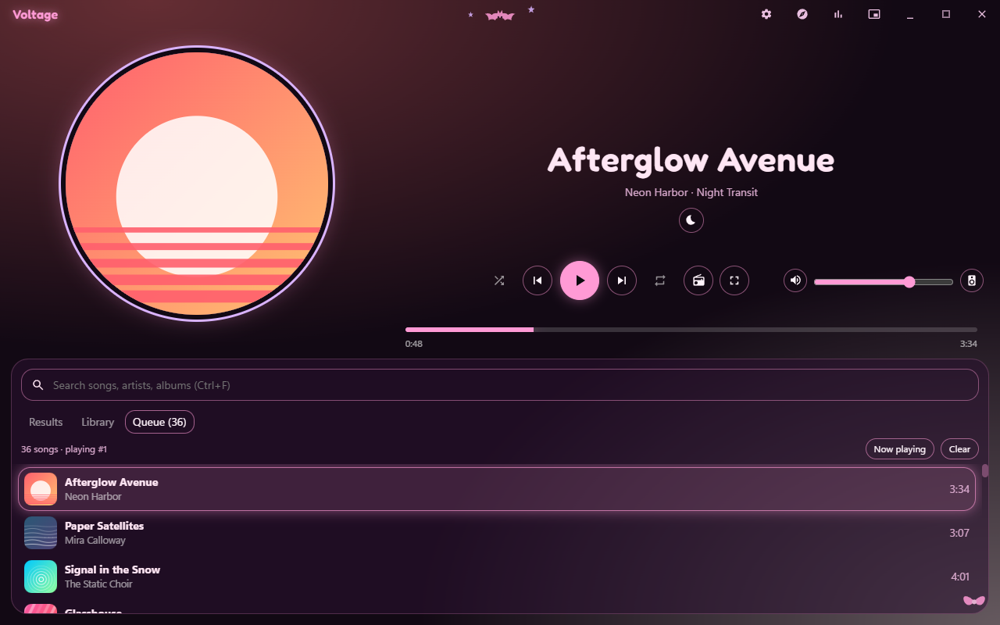
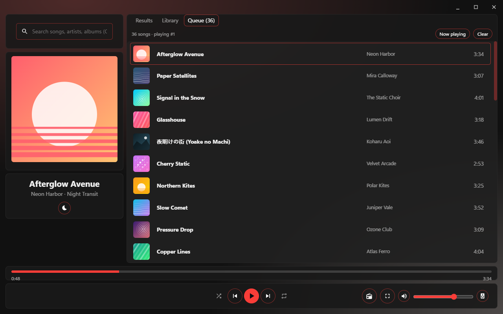
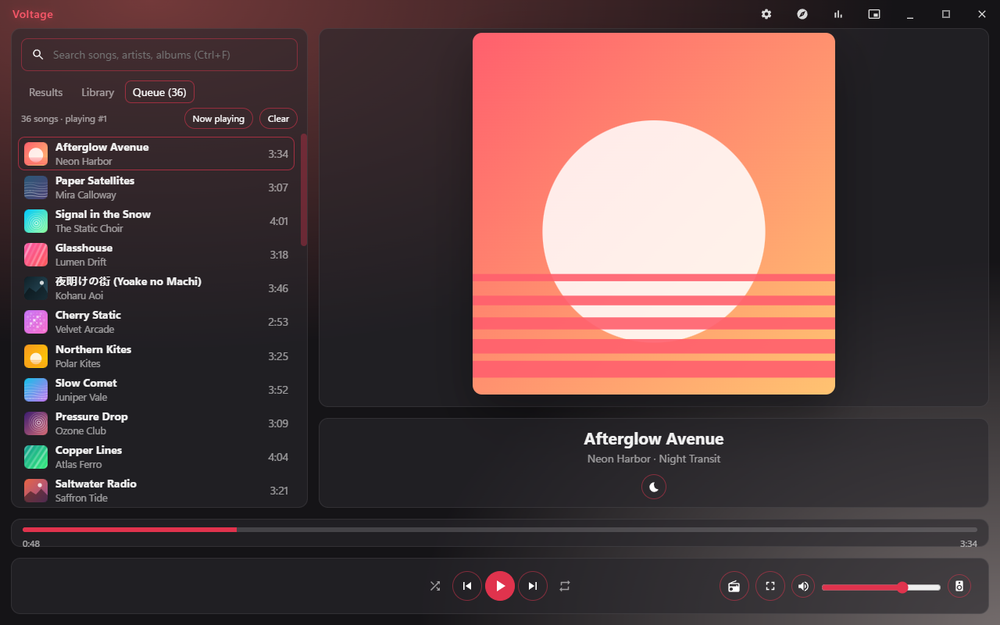
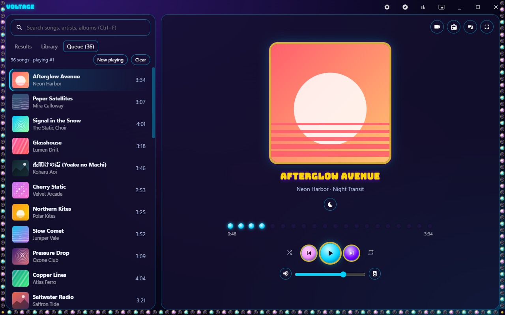
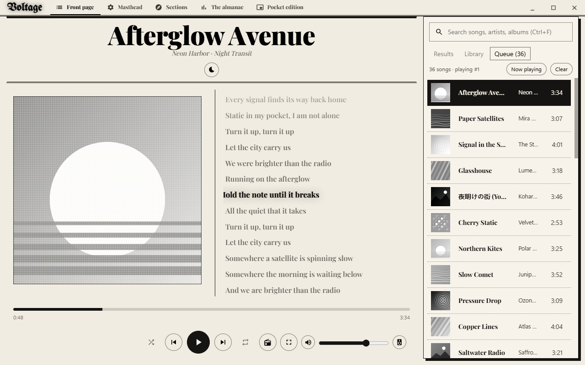
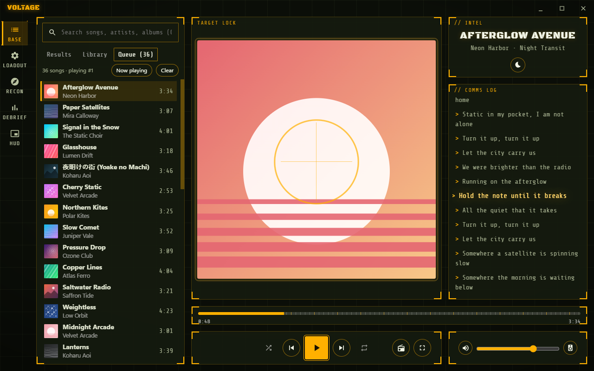
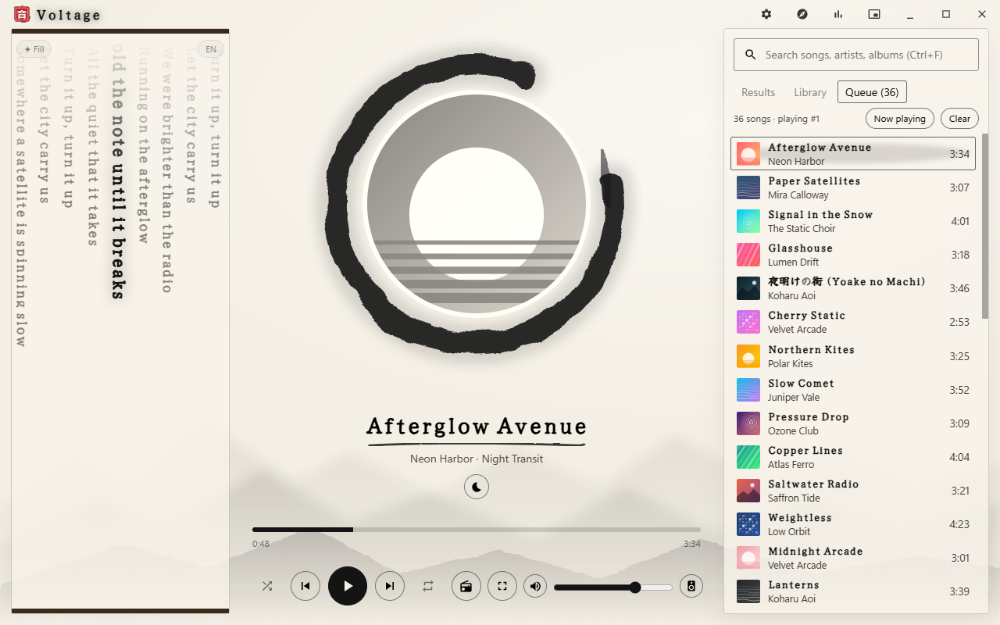

# Theming Voltage

A Voltage theme can change **everything you see**: every colour, font, size, corner, shadow and glow; where each part of
the screen sits; how parts are drawn (a one-line player, an ASCII progress bar, a table of songs); the words on buttons and
tabs; every icon; and it can add images, fonts, UI sounds and a decorative layer over the whole window.

A theme **can't run code**. Anything that needs code (a live visualizer, a clock, a spinning dial) is a
[plugin](GUIDE.md); a theme can name a companion plugin and leave it a place to draw (see "Behaviour" below).

Reference (generated from Voltage's code, so it's always exact): [`themes/theme-reference.md`](themes/theme-reference.md)
(every token, variant, label and icon), [`themes/parts.md`](themes/parts.md) (every part you can style), and
[`themes/theme.schema.json`](themes/theme.schema.json) (autocomplete and error marks in VS Code).

## Examples

Ten complete themes in [`themes/`](themes/), each a folder you can install or copy: `voltage-starter` (Voltage's own look with
every value written out: the best starting point), `terminal` (text only: pixel font, ASCII progress, renamed labels,
scanlines), `crt-green` (green phosphor, vignette, flicker, click sounds), `pastel-goth` (rounded font, round covers,
decorations in the overlay), `sidebar` (a different layout: song table in the middle, player bar along the bottom),
`frosted-light` (follows Windows' light / dark setting), `jackpot` (a video slot: five reels with the cover as the centre
symbol, random landings, a lever, marquee bulbs; works with the Reels plugin), `paper` (a newspaper front page: blackletter
masthead, halftone cover, the lyrics as the article), `tactical` (a gamer HUD: brackets, a reticle over the cover, a comms
log, a HUD mini strip) and `sumi-ink` (ink on washi: the lyrics down a hanging scroll in vertical writing, the cover in an
enso). They're all made by [`themes/tools/make-examples.py`](themes/tools/make-examples.py); the art and sounds made there
are CC0, the fonts are SIL OFL (each with its OFL.txt; see each theme's CREDITS.md).

| | |
|---|---|
| <br>`voltage-starter` | <br>`terminal` |
| <br>`crt-green` | <br>`pastel-goth` |
| <br>`sidebar` | <br>`frosted-light` |
| <br>`jackpot` | <br>`paper` |
| <br>`tactical` | <br>`sumi-ink` |

Each theme's full player is `themes/previews/<id>-2.png`. The pictures use Voltage's **demo library** (`voltage --demo`: made-up
songs and covers, its own data folders, nothing of yours), made with `node tools/theme-previews.mjs` in the Voltage repo.

## Your first theme in 10 minutes

1. Make a folder, for example `C:\themes\neon-night\`, with one file, `theme.json`:

   ```json
   {
     "$schema": "https://raw.githubusercontent.com/CastilloA27/Voltage-Plugins/main/themes/theme.schema.json",
     "id": "neon-night",
     "name": "Neon night",
     "version": "1.0.0",
     "extends": "voltage",
     "tokens": {
       "color.bg": "#05010d",
       "color.text": "#f4e9ff",
       "effect.glow-size": "18px",
       "shape.radius": "20px"
     },
     "accent": { "mode": "fixed", "color": "#ff2fd1" }
   }
   ```

2. In Voltage: **Settings > Appearance > Theme**, paste the folder path in the field, press **Live**. The theme is installed
   and switched on, and from now on **every time you save a file in the folder, Voltage shows the change within a second**.
3. Change `"color.bg"`, save, watch it change. Try `"shape.roundness": "0"` (square corners everywhere).
4. Hold **Ctrl+Shift** and point at anything: Voltage shows its part name (for example `[data-part="player.button.play"]`)
   and its states. That's what you write in CSS.
5. Add a `theme.css` next to `theme.json`, and `"css": "theme.css"` in the manifest:

   ```css
   [data-part="info.title"] { letter-spacing: .08em; text-transform: uppercase; }
   [data-part="tracklist.row"][data-state~="active"] { background: rgb(var(--brand-rgb) / .18); }
   [data-part="app"][data-state~="paused"] [data-part="art"] img { filter: grayscale(1); }
   ```

6. Before sharing: `node tools/theme-check.mjs C:\themes\neon-night` (in the Voltage repo) lists anything Voltage would
   refuse or drop. Share the folder (or zip it); others install it the same way.

A theme can't hide the window buttons: if its CSS hides or covers minimize, maximize or close, Voltage switches that CSS
off and says so under the theme picker. If a theme ever makes Voltage hard to use: tray icon > **Reset look**, or start Voltage with `--safe-mode`.

## The package

```
my-theme/
  theme.json          required: id, name, version
  theme.css           optional, 512 KB at most
  assets/...          images (png, jpg, webp, gif, avif, svg), fonts (woff2, woff, ttf, otf), sounds (ogg, wav, mp3)
```

25 MB and 500 files at most. Plain file names only (letters, digits, `.`, `_`, `-`). Voltage checks every file when it
installs a theme and again when it loads one; a theme that breaks the rules isn't installed, and `theme-check` tells you why.

## theme.json

| Key | What |
|---|---|
| `id`, `name`, `version` | Required. `id`: a-z, 0-9, `-` (not a built-in theme's id) |
| `extends` | Start from another theme: a built-in (`voltage`, `synthwave`, `midnight`, `matrix`, `mono`, `contrast`) or an installed package. Everything you don't set is inherited |
| `appearance` | `dark`, `light` or `system` (follows Windows' light / dark setting, live) |
| `tokens` | Design values, see below |
| `modes` | `{"light": {tokens}, "dark": {tokens}}`: extra tokens for one appearance |
| `accent` | `{"mode": "album"}` (the cover's colour, Voltage's default) or `{"mode": "fixed", "color": "#rrggbb"}` |
| `fonts` | `[{"family": "Terminus", "src": "assets/terminus.woff2"}]`, then use the family in `font.body` etc. |
| `css` | Your stylesheet in the package |
| `layout` | Where parts go, see "Layout" |
| `parts` | Which variant each part uses, see "Variants" |
| `strings` | New words for buttons, tabs and messages |
| `icons` | Your own icons |
| `sounds` | UI sounds |
| `overlay` | `true`: a layer above the whole window for scanlines, vignettes, stickers |
| `plugin` | A companion plugin's id (offered when your theme is installed) |
| `supports` | Settings values that work with your theme, e.g. `{"background": ["cover", "black"]}`: while your theme is on, a setting outside the list is shown as the first listed one. The user's own setting isn't changed, so it comes back with other themes. Settings: `background` (gradient, cover, video, black), `miniSkin` (classic, vinyl, cassette, ring, strip) |

Anything Voltage can't use is listed under the theme picker ("Theme report") and by `theme-check`; the rest still works.

## Tokens

Tokens are named `group.name` (`color.bg`, `shape.roundness`, `font.body`); each sets a CSS variable that Voltage's own styles
read, so one token changes every place that uses it. The full list with Voltage's own values is in
[`themes/theme-reference.md`](themes/theme-reference.md). The ones that matter most:

| Token | Does |
|---|---|
| `color.bg`, `color.text`, `color.text-dim`, `color.text-strong` | Background and text |
| `color.ink` | The colour of every hover, divider and soft overlay (white on dark themes, something dark on light ones) |
| `color.shade` | Shadows and dark overlays |
| `color.surface`, `color.border`, `effect.blur` | The glass panels |
| `shape.radius`, `shape.roundness` | Corner roundness; `shape.roundness` scales every corner (1 = Voltage's, 0 = square, 2 = twice as round) |
| `effect.glow-size`, `effect.glow-alpha` | The neon glow |
| `accent.album-mix` | How much of the cover's colour goes into the background (0-1) |
| `font.body`, `font.mono` | Fonts |

**A light theme** sets `"appearance": "light"`, a light `color.bg`, dark `color.text` / `color.text-strong`, and a dark
`color.ink` (for example `"#14101c"`).

Every colour token takes any CSS colour (`#ff9ad5`, `rgb(...)`, `hotpink`, `oklch(...)`); Voltage works out what it needs.

In your CSS you can use every variable (`var(--bg)`, `rgb(var(--ink) / .1)`, `var(--accent)` = the current accent).

## Layout

The home view is a grid. Name areas, give their sizes, and put a part in each:

```json
"layout": {
  "home": {
    "areas": ["nav main", "prog prog", "bar bar"],
    "columns": "320px 1fr",
    "rows": "1fr 48px 84px",
    "place": { "nav": "sidebar", "main": "nowplaying", "prog": "progress", "bar": "player" },
    "below": { "900px": { "areas": ["main", "bar"], "rows": "1fr 84px", "place": { "main": "tracklist", "bar": "player" } } }
  }
}
```

Parts you can place: `sidebar` (search + tabs + list), `search`, `tracklist` (tabs + list), `nowplaying`, `art`, `info`,
`player`, `progress`, `volume`, `lyrics`, `titlebar` (the title bar with the window buttons, wherever you put it: along the bottom like a taskbar, say; other views keep the normal one), `spacer`, `slot:<name>`. A part placed on its own leaves Now Playing (it never
shows twice); a part you don't place isn't shown (its keyboard shortcuts still work). `below` gives another layout for
windows up to that width. `"resizable": ["nav"]` gives an area a drag handle on its inner edge (double-click resets it); the
width is remembered per theme. It works for an area that is one whole column beside another, with `columns` written out
(no `repeat()`). **A layout must show the song list and a way to play**, or Voltage keeps its own layout (so a
theme can't lock you out of your music). Without `nowplaying`, the `player` cell also carries the volume, Play on (the
output picker), radio and the full-screen button, so nothing is lost.

**The full player and the mini player** can be laid out the same way: `"layout": {"nowplaying": {...}, "mini": {...}}`.
Their parts: `art`, `info`, `lyrics` (full player), `progress`, `player`, `volume`, `back` / `video` (full player), `expand`
(mini, back to the full window), `spacer`, `slot:<name>`. Each must have `player`; if you don't place `back` / `expand`, a
small one floats in a corner. A theme's mini layout replaces the mini-player skin while the theme is on.

```json
"mini": { "areas": ["art meta ctl"], "columns": "56px 1fr auto", "place": { "art": "art", "meta": "info", "ctl": "player" } }
```

**Explore and Stats** (Voltage 1.7.3+): `"layout": {"explore": {...}, "stats": {...}}`. The page itself is one part
(`explore` / `stats`, with its own back button and scrolling) and must be placed; beside it you can put `art`, `info`,
`lyrics`, `progress`, `player`, `volume`, `spacer`, `slot:<name>`. Their grids have the classes `lay-view-explore` /
`lay-view-stats`; the page inside is `[data-part="explore.page"]` / `[data-part="stats.page"]`.

```json
"explore": { "areas": ["page art", "page info", "bar bar"], "columns": "minmax(0, 1fr) 260px", "rows": "260px minmax(0, 1fr) 76px",
  "place": { "page": "explore", "art": "art", "info": "info", "bar": "player" } }
```

### Styling the cells

Every cell is `<div class="lay-area lay-<part>" data-area="<your area name>" data-cell="<part>">` (a slot's class is
`lay-slot-<name>`). The full player's grid has the class `lay-view-nowplaying`, the mini player's `lay-view-mini`, so
`.lay-art` is the home view's cover cell and `.lay-view-nowplaying [data-cell="art"]` the full player's. Grid sizes can use
`var()` / `calc()` / `clamp()`, so a theme can size its grid from its own CSS variables (Jackpot's reels shrink on short
windows: `--reel: clamp(96px, calc((100vh - 330px) / 3), 180px)` and `"columns": "1fr repeat(5, var(--reel)) 1fr"`).

Recipes the example themes use:

| Want | CSS |
|---|---|
| Cells without the glass panel (one open composition) | `.lay-art, .lay-info { background-color: transparent !important; border-color: transparent !important; box-shadow: none !important; backdrop-filter: none !important; }` |
| A cover that always fits its cell | `.lay-art .art-part { display: grid; grid-template: minmax(0, 1fr) / minmax(0, 1fr); place-items: center; width: 100%; height: 100%; min-height: 0; }` and `.lay-art img { width: auto !important; height: auto !important; max-width: 100% !important; max-height: 100% !important; aspect-ratio: 1; object-fit: cover; }` (without the `grid-template`, the wrapper's row grows to the picture and the cover overflows) |
| A label on a cell | `.lay-lyrics { position: relative; padding-top: 26px; } .lay-lyrics::before { content: "// COMMS LOG"; position: absolute; top: 6px; left: 12px; }` (Tactical, Terminal) |
| Lyrics as a column of text | `.lay-lyrics .lyrics { width: 100% !important; height: 100% !important; padding: 30% 8px !important; text-align: left; }` and `.lay-lyrics .lyrics p.on { transform-origin: left center; }` (the sung line grows a little; from its left edge it isn't clipped) |
| Lyrics written top to bottom | `.lay-lyrics .lyrics { writing-mode: vertical-rl; }` plus the sizes above (Sumi Ink; the line being sung still scrolls into view) |
| The nav as tabs or a rail | `"parts": {"nav": {"variant": "tabs"}}` (beside the brand) or `"sidebar"` (a rail down the left); both add Home (`nav.home`) and show a word under / beside each icon: rename them in `strings` (Paper: Front page, Sections...; Tactical: Base, Recon...) |
| Corner brackets on every cell | eight `linear-gradient` layers with `background-size` / `background-position` per corner (Tactical's theme.css) |

A placed `lyrics` cell loads the lyrics by itself, whatever the lyrics button says. Check a layout at **1280 x 800** and
**1366 x 768** as well as full screen: Voltage's demo library (`voltage --demo`) makes that safe to screenshot.

## Variants

Some parts can be drawn in different ways: `"parts": {"progress": {"variant": "ascii"}}`.

| Part | Variants (the first is Voltage's) |
|---|---|
| `player` | `panel`, `compact`, `text` (words instead of icons, from `strings`), `bar` (a bar along the bottom, when your theme has no home layout of its own) |
| `progress` | `wave`, `line`, `blocks`, `ascii` (`[######------] 1:23 / 3:14`), `none` |
| `tracklist` | `rows`, `dense`, `table`, `text` (one monospace line per song), `cards` (a grid of cover cards) |
| `nav` | `icons`, `text` (in the title bar), `tabs` (labelled tabs beside the brand), `sidebar` (a rail down the left); tabs and the rail add Home |
| `art` | `cover`, `round`, `vinyl` (round, spins while playing), `none` |
| `lyrics` | `karaoke`, `plain`, `ticker` (only the current line) |
| `titlebar` | `full`, `minimal`, `hidden` (the window buttons always stay) |

## Words and icons

`"strings": {"tab.library": "ls ~/music", "player.play": "[ play ]"}`: plain text, 60 characters at most. Every key is
in the reference. Permission prompts and other safety texts can't be changed.

`"icons": {"play": "assets/icons/play.svg", "pause": {"text": "||"}}`: an svg / png / webp from your package (drawn in
the text colour, like Voltage's own) or up to 8 characters of text. Icon names are in the reference.

## Fonts, sounds, overlay

- **Fonts:** `"fonts": [{"family": "Terminus", "src": "assets/terminus.woff2", "weight": 400}]`, then
  `"tokens": {"font.body": "Terminus, monospace"}`. Use fonts whose licence allows it (OFL fonts are a safe choice).
- **Sounds:** `"sounds": {"click": "sfx/click.ogg", "navigate": "sfx/tab.ogg"}`. Events: `click`, `hover`, `navigate`,
  `open`, `close`, `play`, `pause`, `skip`, `like`, `notify`, `error`. 1 MB and 3 seconds at most each. **Off until the
  user turns on Settings > Appearance > Theme sounds**, and always silent while gaming.
- **Overlay:** `"overlay": true` adds `[data-part="overlay"]` over the whole window; style it in your CSS
  (`background: repeating-linear-gradient(...)` for scanlines, `radial-gradient(...)` for a vignette, an image for
  stickers). It never takes clicks, and it disappears while a permission prompt is open.

## Moments: animate on what happens

For about 1.2 seconds after something happens, `<html>` carries `data-event`: `track-change`, `skip`, `previous`, `seek`,
`like`, `unlike`, `shuffle`, `queue-add`, `download-done` (a new one restarts it). Not set while gaming or with reduced motion.

```css
:root[data-event="like"] [data-part="art"] { animation: pop .6s ease; }
:root[data-event="track-change"] [data-part="info.title"] { animation: slide-in .5s ease; }
@keyframes pop { 50% { transform: scale(1.06); } }
```

**Rolls:** on every new song `--fx-roll-1` ... `--fx-roll-5` on `<html>` get fresh random whole numbers 0-7, e.g. for slot
reels: `background-position-y: calc(var(--fx-roll-1) * -100px)` (see the Jackpot theme).

**Your helper's effects** (`ui.fx`, while your theme names the plugin in `"plugin"`): `voltage.theme.vars({hp: 0.42})` sets
`--fx-hp` on `<html>` (numbers, lengths, angles, %, colours, keywords; 32 names), and `voltage.theme.state('app', ['rare'])`
sets `data-fx="rare"` on `[data-part="app"]`. The Reels plugin does both for Jackpot: `--fx-roll-1..5` (it overrides the
random rolls) and `[data-part="app"][data-fx~="legendary"]`. Everything is cleared when the plugin stops or your theme is
switched off.

**Reduce flashing** (Voltage 1.7.2+): while it's on (or unset with Windows' reduced motion), `<html>` has `data-reduce-flash`.
Any flicker or strobe of your own must stop there: `:root[data-reduce-flash] .my-flicker { animation: none; }`.

**Canvas layers** (Voltage 1.7.2+, `ui.fx`): `voltage.theme.layer('background', {gl: true, fps: 30})` gives your helper an
OffscreenCanvas (2D or WebGL2) under everything, over the window (`'overlay'`), over the cover (`'part:art'`) or the mini
player (`'mini'`). Voltage drives it: a `frame` event `{t, dt, progress, level, beat, seed}` once per frame (the next one comes
when your handler returns; `level` / `beat` need them in your theme's `"uses"`). The limits: 1-60 frames a second (30), at most
one device pixel (half for the background), no frames while gaming, hidden or with reduced motion, hidden while a security
prompt is open, and a frame that averages over 8 ms for 3 s halves the rate, then stops the layers with a note. See the Aurora
theme (Voltage-Themes) and its `aurora-sky` helper: a WebGL sky, 0.4 ms of work a frame.

## Holiday hello

On a holiday Voltage plays a short hello the first time its window opens that day (Settings > Appearance > Holiday surprises).
While it shows, `<html>` has `data-holiday="<id>"` and the hello sits in `[data-part="holiday"]`: the logo (`.hol-logo`),
the greeting (`.hol-greeting`), a line under it (`.hol-sub`), the particles (`.hol-p`), a row of lights (`.hol-row-item`) and
the menorah (`.hol-menorah`). Your tokens and fonts already apply; restyle it or replace its keyframes:

```css
:root[data-holiday="halloween"] .hol-greeting { font-family: "Bungee", sans-serif; color: #ff8a00; }
[data-part="holiday"] .hol-logo { letter-spacing: .2em; }
```

Ids: `new-year`, `lunar-new-year`, `valentine`, `st-patrick`, `easter`, `eid-al-fitr`, `mothers-day`, `music-day`, `juneteenth`,
`fathers-day`, `independence`, `halloween`, `dia-de-muertos`, `diwali`, `thanksgiving`, `hanukkah`, `christmas`,
`new-years-eve`, `voltage-birthday`, `your-birthday`. `"holidays": false` in theme.json turns them off while your theme is on. With Theme sounds on, the hello plays your `holiday` sound (in `sounds`), or else your `notify` or `like` sound.

## Behaviour: a companion plugin

A theme has no code. For anything that moves on its own or reacts (an ASCII visualizer for a terminal theme, a radio dial),
write a [plugin](GUIDE.md), name it in `"plugin"`, and give it a place in your layout with a cell `slot:<name>`. The plugin
lists `theme.<name>` in `provides.slots` and draws there with `voltage.slot.render('theme.<name>', html, css)`.

## CSS rules

Your CSS applies only while your theme is on. Removed by Voltage: `@import`, any `url()` that isn't a file in your package
or an inline image, `position: fixed` (use the overlay), `expression()` / bindings, and selectors that read what someone
types. **Style parts, not class names:** `[data-part="..."]` and `[data-state~="..."]` are promised not to change in
Voltage 1.x; Voltage's own class names can change in any update.

## Old themes (v1)

Themes made in the theme editor before packages (the colour / panel / font editor, shared as JSON) keep working exactly as
before.
